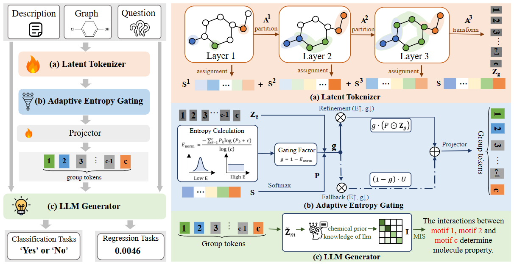

# 🔗 TAGA: Task-Adaptive Graph Tokenization Augmentation Framework

TAGA converts graph-structured inputs into task-adaptive group tokens that can be consumed directly by a large language model (LLM). Instead of relying on a fixed graph vocabulary, TAGA learns soft node-to-channel assignments from context-aware node representations and uses the resulting group tokens as structural augmentation signals for answer generation.

<p align="center">
  
</p>
<p align="center"><em>Overview of TAGA: Latent Tokenizer, Adaptive Entropy Gating, and LLM Generator.</em></p>

## 🧠 Method Overview

TAGA contains three components:

1. **Latent Tokenizer.** A graph encoder first produces context-aware node representations. Layer-specific projections map the nodes to latent channels, and normalized node-to-channel attribution scores form a soft, task-adaptive partition. The final-layer mapping produces the raw group tokens.
2. **Adaptive Entropy Gating (AEG).** Node-level attribution scores are summarized into task-adaptive channel scores. Their normalized entropy is then used to calibrate the channel weights, emphasizing informative group tokens while reducing unstable or weakly supported structural signals.
3. **LLM Generator.** The entropy-weighted group tokens and the natural-language task instruction jointly condition a frozen LLM to generate the answer.

The framework is evaluated on molecular graph classification, property regression, and molecule caption generation. 

## 🗂️ Code Structure

```text
Mol2Token/
├── assets/
│   └── framework.png          # TAGA framework overview
├── rebuttle/
│   ├── LLM_prompt.md          # LLM input format
│   ├── motif_partioning.py    # Post-hoc motif partition analysis
│   ├── overlap_ratio.py       # Motif-overlap analysis
│   ├── proof.md               # Theoretical analysis of AEG
│   └── MIS/
│       ├── cls_atten.sh       # Classification interaction analysis
│       ├── rg_atten.sh        # Regression interaction analysis
│       └── llm_atten_map.py   # LLM attention-map analysis
├── model/
│   ├── llaga_arch.py          # Graph-token integration and AEG
│   ├── builder.py             # Model loading
│   └── graph_encoder/
│       ├── neuralFP.py        # Graph encoder
│       └── neuralfingerprint/ # Neural fingerprint implementation
├── train/
│   ├── train.py               # Training pipeline
│   ├── train_mem.py           # Memory-efficient training entry point
│   └── llaga_trainer.py       # Trainer
├── eval/
│   ├── moleculenet_classification.py  # Classification evaluation
│   ├── qm9_regression.py              # QM9 regression evaluation
│   ├── lipo_regression.py             # Lipophilicity regression evaluation
│   ├── pc_regression.py               # Physical-chemistry regression evaluation
│   └── chebi20_caption.py             # Molecule caption evaluation
├── scripts/
│   ├── my_train.sh            # Configurable single training run
│   ├── run_all_cls.sh         # Classification training and evaluation
│   ├── run_qm9.sh             # QM9 training and evaluation
│   ├── run_pc.sh              # Physical-chemistry training and evaluation
│   ├── run_chebi20.sh         # ChEBI-20 training and evaluation
│   └── eval_all.sh            # Classification evaluation
├── llm_ckpt/                  # Base LLM checkpoints
└── checkpoints/               # TAGA checkpoints
```

## 🧪 Datasets

| Task | Category | Datasets |
|------|----------|----------|
| Classification | Toxicity | SIDER, ClinTox, Tox21 |
| Classification | Biochemistry | BACE, HIV, MUV |
| Classification | Physiology | BBBP, CYP450 |
| Regression | Physical chemistry | ESOL, FreeSolv, Lipophilicity (Lipo) |
| Regression | Quantum chemistry | QM9 |
| Generation | Molecule captioning | ChEBI-20 |

Property-prediction datasets use an 80/10/10 scaffold split. In the molecular experiments, the learned group tokens can be localized to graph regions and interpreted post hoc as implicit motifs.

## 🚀 Quick Start

Run all commands from the repository root. Place the base LLM checkpoint under `llm_ckpt/` and prepare each task dataset as JSONL files under `dataset/<dataset>/` before training or evaluation.

### Classification

Train and evaluate all supported classification datasets:

```bash
bash scripts/run_all_cls.sh
```

Evaluate existing classification checkpoints:

```bash
bash scripts/eval_all.sh
```

### Regression

Train and evaluate QM9:

```bash
bash scripts/run_qm9.sh
```

Train and evaluate the configured physical-chemistry dataset:

```bash
bash scripts/run_pc.sh
```

### Molecule Caption Generation

Train and evaluate ChEBI-20:

```bash
bash scripts/run_chebi20.sh
```
